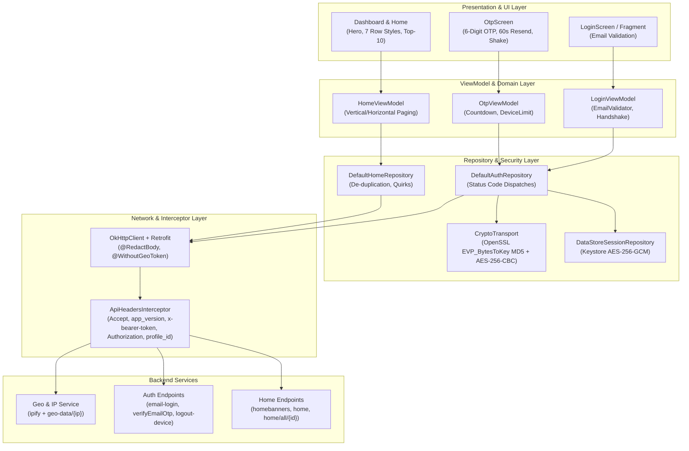
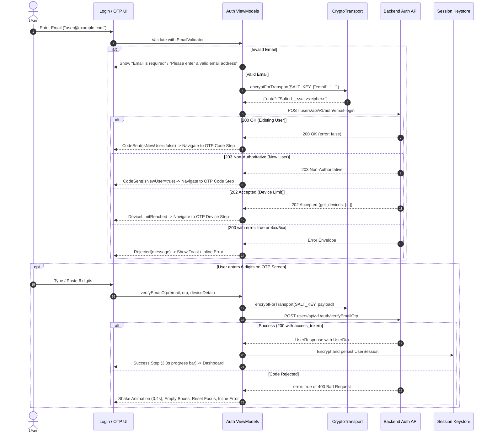

# VPlayed 3.0 — End-to-End Deep Integration & Contract Testing Plan

Comprehensive integration testing architecture, input/output validation matrices, cryptographic transport rules, and automated test suite specifications for the VPlayed 3.0 Android OTT platform.

---

## 1. Architectural Overview & Test Tiers



---

## 2. In-and-Out Flow Matrix

### Flow A: Public IP & Geo-Restriction Handshake
- **Input**: App Launch / Network Reconnect.
- **Out 1**: `GET https://api.ipify.org/?format=json` (Isolated client, no app headers).
  - *Response Validation*: `{"ip": "..."}` matching IPv4 (`^[0-9.]{7,15}$`) or IPv6.
- **Out 2**: `GET mediaview/api/v1/common/geo-data/{ip}` (Marked `@WithoutGeoToken`).
  - *Response Validation*: Envelope containing `response.geo_token`.
  - *Transformation*: Base64 decode -> JSON parse -> extract `currency`.
  - *State Mutation*: Cached in `GeoRestrictionStore` and injected into all subsequent calls as `x-bearer-token`.

---

### Flow B: Email Login & OTP Verification Flow



---

## 3. Exhaustive API Response Validation Matrix

All backend responses must conform to the standard envelope:
```json
{
  "statusCode": 200,
  "status": "success",
  "message": "...",
  "error": false,
  "response": {}
}
```

### Complete Field-Level Quirk & Normalization Rules

| Endpoint | Field | Allowed Raw Wire Types | App Normalization Rule | Failure Fallback |
|---|---|---|---|---|
| `common/geo-data` | `geo_token` | Base64 String | Decoded as UTF-8 JSON; extract `currency` string | Keep existing cached currency; do not crash |
| `auth/email-login` | `statusCode` | Integer (`200`, `202`, `203`) | HTTP status code takes precedence over envelope status | Reject if 200 has `error: true` |
| `auth/verifyEmailOtp`| `device_limit` | Integer or String (`"5"` or `5`) | Parsed via `JsonPrimitive.intOrNull` | Nullable |
| `auth/verifyEmailOtp`| `profile_count` | Integer or String | Parsed leniently; `> 1` sets `hasMultipleProfiles` flag | Defaults to 1 |
| `homebanners` | `video_duration` | String (`"267.72"`) or Number (`125`) | Parsed as total seconds float/double -> formatted time | `0:00` |
| `homebanners` | `title_images` | PNG/WebP ImageSet or AVIF `title_image` | Mobile PNG `title_images.default.mobile` > `web` > `title_image` | Fallback to title text string |
| `home` | `title` | Plain String on `/home` vs Localized object `{"en": "..."}` on `/all/{id}` | Normalized via `localizedText()` | Fallback to `name` or empty string |
| `home` | `prices` | Array with multiple currency objects | Select item where `currency_type == 1` (INR) or active geo currency | Free / No price badge |
| `home` | `discounted_price`| Number (Discount amount taken OFF total) | Real price = `amount - discounted_price`; strike through `amount` | No discount if `discounted_price <= 0` |
| `home` | `streaming_status`| Integer (0, 1, 2) | `1` = LIVE pill; `0` = UPCOMING pill; `2` = Finished (no badge) | No badge |

---

## 4. Input Field Validation & Sanitization Matrix

| Input Field | Boundary Rules | Sanitization / Preprocessing | UI Error Response |
|---|---|---|---|
| **Email ID** | 5 to 254 chars; RFC 5321 Regex: `^[A-Za-z0-9._%+-]+@[A-Za-z0-9.-]+\.[A-Za-z]{2,}$` | `input.trim()` | Empty: *"Email is required"*<br>Invalid format: *"Please enter a valid email address"* |
| **OTP Code** | Exactly 6 numeric digits `[0-9]{6}` | Strips dashes, spaces, letters: `input.filter { it.isDigit() }.take(6)` | Incomplete: Verify button disabled<br>Refused: Inline error under boxes + 0.4s card shake |
| **OTP Resend** | 60-second cooldown timer | Virtual time tick every 1000ms | Disabled with label: *"Resend in {m}:{ss}"*<br>Enabled at 0s with active brand red |
| **Device Preference** | Exact enum string: `"1"` or `"all"` | Strictly literal mapped | Disables button while request in flight |

---

## 5. Automated Test Specification Files (YAML)

Two comprehensive machine-readable YAML test specification files have been created in `docs/testing/specs/`:

1. **[`api-contract-and-integration-suite.yaml`](specs/api-contract-and-integration-suite.yaml)**:
   - Contains all 9 network endpoints.
   - Request specification: method, path, headers, conditional tokens, plain payloads, and encrypted wrappers.
   - Response validation rules: success envelopes, status code branches (200, 202, 203), HTTP error envelopes (400, 401, 500), timeout and offline behavior.
   - Field-level type and schema validation.

2. **[`input-validation-test-suite.yaml`](specs/input-validation-test-suite.yaml)**:
   - Full test cases for Email field (empty, whitespace, malformed, SQLi/XSS, valid edge cases).
   - Full test cases for OTP field (length boundaries, non-digit rejection, SMS copy-paste sanitization).
   - Full test cases for 60s resend timer and remote device sign-out actions.
   - Full test cases for IP format and Base64 geo token decoding.

---

## 6. Execution & Verification Commands

```bash
# Set JDK 25
export JAVA_HOME="/Applications/Android Studio.app/Contents/jbr/Contents/Home"

# Run all unit and integration contract tests
./gradlew testDevUnitTest testQaUnitTest testStageUnitTest testDemoUnitTest testReleaseUnitTest

# Run connected Compose UI and end-to-end flow tests on emulator
./gradlew connectedDevAndroidTest

# Verify Lint compliance
./gradlew lintDev lintRelease
```
